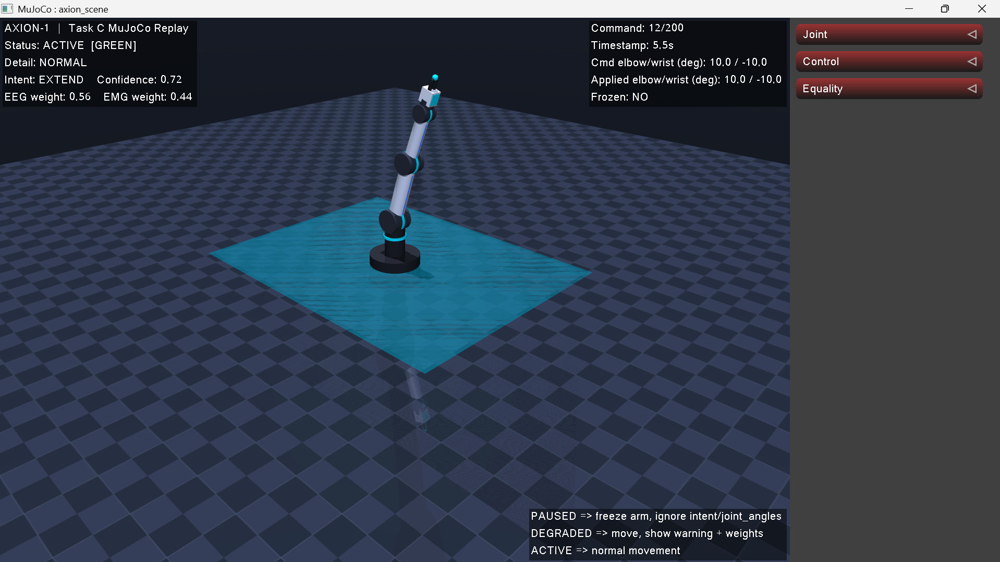
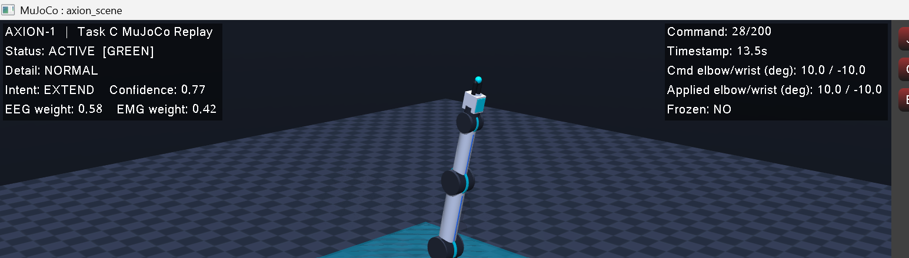

# AXION-1 — Adaptive Neuro-Mirroring Interface (MuJoCo Demo)

AXION-1 is a post-stroke assistive BCI rehabilitation concept: **EEG + EMG -> intent/safety decision -> robot arm movement**.  
Built for the **2026 Neural Village Hackathon**, in collaboration with **MathWorks**.

This repository contains the MuJoCo simulation layer (Task C). **MuJoCo does not process raw EEG/EMG signals** - it consumes precomputed command decisions from `data/commands.json` and replays them on a 2-DOF assistive arm with safety-aware behavior.

## Demo Preview

| Full MuJoCo Scene | Status / HUD Areas |
|---|---|
|  |  |

## Project Overview

AXION-1 explores a practical assistive-control loop for motor rehabilitation:
- **Brain signal (EEG)** captures motor intent.
- **Muscle signal (EMG)** captures physical activation and fatigue/spasm indicators.
- **Adaptive fusion logic** decides how much to trust EEG vs EMG and enforces safety states.
- **MuJoCo simulation** visualizes the resulting arm behavior in a clear, demo-ready environment.

### Why MuJoCo
For this phase, MuJoCo provides a fast, lightweight, reproducible robotics simulation path (no ROS2 dependency). It lets us validate command replay, safety behavior, and demo UX before moving to hardware integration.

## Pipeline (End-to-End)

| Stage | Role | Input | Output | Location |
|---|---|---|---|---|
| **Task A — Signal Processing** | Clean/extract EEG+EMG features (upstream, MATLAB) | Raw biosignals | Feature windows + quality scores | `phase2/output/axion1_features.csv` etc. |
| **Task B — ML + Adaptive Engine** | Classify intent, compute weights, apply safety logic | Task A features | Command/decision streams | `phase2/train_axion_ml.py`, `phase2/axion_adaptive_engine.py` |
| **Task C — MuJoCo Replay** | Visualize arm movement safely in real time | `data/commands.json` | On-screen 2-DOF arm replay + HUD | `sim/replay.py`, `sim/assets/` |

## What’s Included in This Repo

- **Canonical replay input**: `data/commands.json` (200 commands, 0.5s cadence, 0.0–99.5s)
- **MuJoCo Task C simulator**: custom vendored 2-DOF arm + replay script + HUD
- **Phase 2 bundle artifacts**: ML scripts, trained model, feature outputs, metadata
- **Docs/assets**: brief PDF, degradation figure, demo screenshots
- **Archives**: original ZIPs preserved for traceability

## Task C — MuJoCo Arm Replay (Current Build)
Input: `data/commands.json` (200 commands, 0.5s cadence, 0–99.5s).  
Each command already contains the decision:

```json
{
  "timestamp": 0.5,
  "intent": "flex",
  "confidence": 0.84,
  "source_weights": {"eeg": 0.58, "emg": 0.42},
  "safety_status": "ACTIVE",
  "joint_angles": {"elbow": 45.0, "wrist": 10.0}
}
```

### Safety Contract (Implemented Exactly)
- `ACTIVE` — move arm to commanded angles; normal/green status.
- `DEGRADED` — move arm, but show amber warning and display `source_weights` (adaptive EEG/EMG trust shift).
- `PAUSED` — **freeze arm** and ignore `intent` and `joint_angles` until status returns to `ACTIVE` or `DEGRADED`.

### Command Stream Notes (Important)
- The replay is **faithful to the command stream**. The arm only moves as commanded by `data/commands.json`.
- Current `commands.json` uses 3 pose targets: `rest (0,0)`, `flex (45,10)`, `extend (10,-10)` (deg), with many 0.5s switches.  
  This means motion can look repetitive/up-down, which is expected for this dataset.
- For a smoother visual demo (presentation only), use `--smooth 0.08`; for exact/raw replay, use default settings.

## Project Structure
```text
axion/
  README.md
  requirements.txt
  .gitignore
  assets/                         # README/demo images
    full_scene_img.png
    image_of_stat_areas.png
  data/
    commands.json                 # Canonical MuJoCo replay command stream
  docs/
    Axion_v1_Brief.pdf
    figures/fig4_degradation_demo.png
  phase2/                         # Extracted Phase 2 bundle (Task A/B)
    README.md
    train_axion_ml.py
    axion_adaptive_engine.py
    run_task_b.py
    run_task_b.bat
    models/axion_models.joblib
    output/
      axion1_features.csv
      axion1_features.mat
      axion1_degraded_quality.mat
      axion1_metadata.txt
      axion_live_commands.json    # Earlier/different schema (traceability)
  sim/
    assets/
      axion_arm.xml               # Vendored custom 2-DOF assistive arm (MJCF)
      scene.xml                   # Camera, lighting, floor/workspace
    replay.py                     # MuJoCo passive viewer replay + HUD + safety
    README.md
  archives/                       # Original zips preserved
    axion_phase2_bundle.zip
    output.zip
    figures.zip
```

## Quick Start (Windows / PowerShell)

```powershell
cd C:\Users\User\Desktop\axion
python -m pip install -r requirements.txt
python sim/replay.py
```

### Useful Runtime Options
```powershell
python sim/replay.py --speed 1.0          # real-time 0.5s/command
python sim/replay.py --speed 2.0          # faster demo playback
python sim/replay.py --smooth 0.08        # visual smoothing (presentation mode)
python sim/replay.py --smoke              # headless validation, no GUI
```

### Viewer Controls
- `R` — restart replay from beginning
- Mouse wheel — zoom in/out
- Left-drag — rotate camera
- Right-drag — pan camera

## Arm Design (Task C)

Custom **2-DOF assistive manipulator** (vendored MJCF, no external model dependency):
- **Joints**: `elbow`, `wrist` (hinge; radians internally, degrees in command JSON)
- **Actuators**: `elbow_act`, `wrist_act` (position actuators)
- **Direct mapping**: `joint_angles.elbow`, `joint_angles.wrist` -> actuator targets
- **Visuals**: pedestal/base, upper arm, forearm, end-effector, cyan accent styling, studio lighting, fixed cameras
- **Demo focus**: clear, stable, hackathon-ready visualization of command + safety behavior

## Data / Contract Summary

### `data/commands.json` (Canonical Sim Input)
- **Count**: 200 commands
- **Cadence**: 0.5 seconds (`0.0` to `99.5`)
- **Intents**: `rest`, `flex`, `extend`
- **Safety statuses**: `ACTIVE`, `DEGRADED`, `PAUSED`
- **Joint angles**: `elbow`, `wrist` (degrees)

### Observed Status Progression
`ACTIVE (clean) -> DEGRADED (fatigue/adaptive shift) -> PAUSED bursts (spasm/safety) -> DEGRADED (recovery) -> ACTIVE`

## Validation Performed

- `commands.json` schema/keys validated (200 commands; required fields present).
- Headless smoke replay: `python sim/replay.py --smoke --smoke-steps 200` -> `SMOKE_OK steps=200`.
- Safety behavior verified:
  - `PAUSED` freezes arm and ignores command angles/intent
  - `DEGRADED` continues movement and displays warning + weights
  - `ACTIVE` resumes normal movement
- Transition sequence verified against expected stream timings (including PAUSED bursts around 57.5–74.0s and recovery to ACTIVE at 86.0s).

## Hackathon Context

- **Event**: 2026 Neural Village Hackathon
- **Collaboration**: MathWorks
- **Project theme**: Assistive neurotechnology / motor rehabilitation interface
- **Current demo scope**: MuJoCo replay of precomputed multimodal decisions (Task C), with safety-state visualization

## Limitations & Next Steps

- **Current limitation**: Replay uses a compact 2-DOF command set (no gripper, no object interaction/pick-place in this stream).
- **Current limitation**: `commands.json` is precomputed; no live EEG/EMG streaming in this repo yet.
- **Next step**: Stream live Task B outputs into MuJoCo in real time.
- **Next step**: Add richer task scenes (reach/grasp/object interaction) and hardware-in-the-loop control.
- **Next step**: Extend evaluation with clinician-facing metrics and user studies.

## Notes

- `data/commands.json` is the **canonical** MuJoCo replay input.
- `phase2/output/axion_live_commands.json` uses a different earlier schema (135 windows, `FLEX/EXTEND/HOLD`, shoulder/elbow/wrist) and is kept for traceability.
- Original project zips are preserved in `archives/`.
